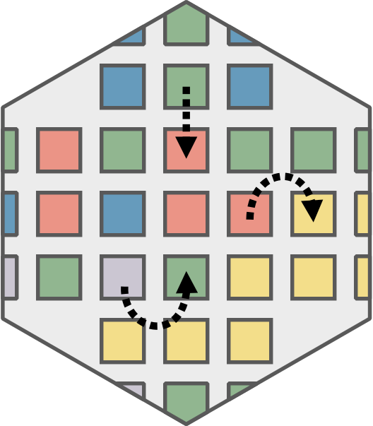

# evoland-plus 

## Overview

The `evoland-plus` R package (`evoland` for evolving land use, `plus` for [plus.ethz.ch](https://plus.ethz.ch/)) provides tools for land use change simulations. The package implements a statistically calibrated, constrained model for predicting locations of future land use / land cover change (LULCC).
The scope of `evoland-plus` is to:

- **Gather and process** LULCC and predictor data from multiple sources into a clearly defined database structure.
- **Calibrate statistical models** to understand historical land use transitions
- **Project future land use patterns** using predictive models and allocation algorithms
- **Support scenario analysis** through interventions and parameter modifications

## Installation

Install the development version from GitHub:

```r
# install.packages("remotes")
remotes::install_github("ethzplus/evoland-plus")
library(evoland)
```

The package compiles C++ code, so you need a working build toolchain (Rtools on Windows, Xcode command line tools on macOS), and [terra](https://rspatial.github.io/terra/) needs GDAL and PROJ.

If you manage project libraries with [rv](https://a2-ai.github.io/rv-docs/), add the package to your `rproject.toml` instead:

```toml
dependencies = [
    { name = "evoland", git = "https://github.com/ethzplus/evoland-plus/", branch = "main" },
]
```

## Contributing

PRs are very welcome!
It's probably best to first discuss the underlying issue; @mmyrte is very happy to help figure out a solution.
Conventions for R, C++, SQL and prose are collected in the [style guide](devdocs/style/README.md); [AGENTS.md](AGENTS.md) has the project layout and development commands.
Code should be formatted with [air](https://posit-dev.github.io/air/) before committing.
Tests are written as `tinytest`s that can be run after package installation, ensuring that your system is set up correctly.

To work on the package itself with rv, install only its dependencies and load the package from your checkout:

```toml
dependencies = [
    # only install dependencies declared in DESCRIPTION
    { name = "evoland", path = "~/path/to/local/repo", dependencies_only = true, install_suggestions = true },
    "devtools", # sundry development tasks
    "mirai", # modern multiprocessing
    "httpgd", # webview plotting
    "languageserver", # assuming your IDE loads the rv library instead of system
]
```

`devtools::load_all()` then acts as though you were calling `library(evoland)` on an installed package, which makes it easy to reload code after a change.

## Allocation

`evoland-plus` places projected land use change on the map with `allocate(db, id_periods, allocator)`, using one of three allocators:

- `alloc_clumpy_spec()`: stochastic patch-based allocation after [CLUMPY](https://github.com/mmyrte/clumpy), implemented in C++ and available wherever the package installs.
- `alloc_greedy_spec()`: deterministic rank-and-fill allocation, a baseline for comparison.
- `alloc_dinamica_spec()`: allocation with [Dinamica EGO](https://dinamicaego.com/), which is optional. Dinamica only runs on **Linux x86 / amd64** (the Windows installer exists but is untested with `evoland-plus`); see the [Installing Dinamica EGO](https://ethzplus.github.io/evoland-plus/articles/install-dinamica.html) vignette, or use the [Docker container](https://github.com/ethzplus/rocker-geospatial-dinamica/) on other platforms.

## Documentation

This package uses pkgdown, see <http://ethzplus.github.io/evoland-plus>.

- **Tutorials & How-to Guides**: Package vignettes and examples in R man pages
- **Reference Documentation**: R man pages using the standard `?function_name`
- **Explanation & Design Rationale**: See [`devdocs/design/`](devdocs/design/) for the modelling workflow, the database schema and architecture decisions
- **Development guidelines and coding standards**: See the [style guide](devdocs/style/README.md)

## License

This project is licensed under the AGPL-3 License - see the [LICENSE.md](LICENSE.md) file for details.

## Acknowledgments

This work represents a re-implementation and enhancement of [Benjamin Black's](/blenback) land use model published at <https://github.com/ethzplus/evoland-plus-legacy>, building on substantial prior experience while modernizing the technical implementation.
