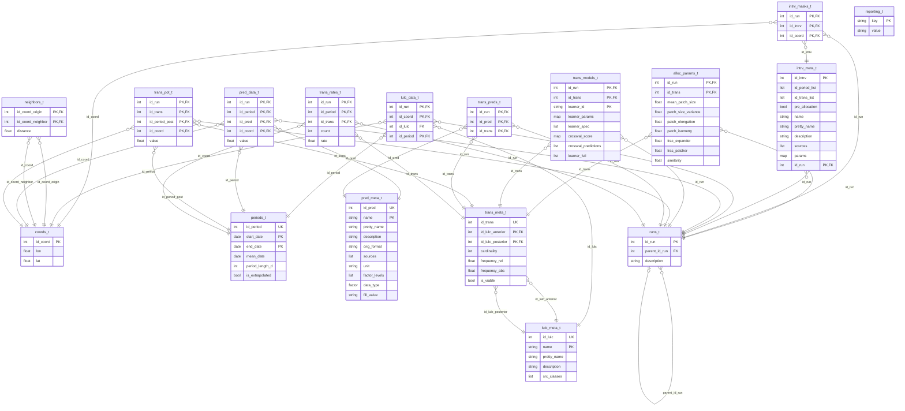

# Data model

## Overview

The analytic workflow is centrally managed around a relational database.
The database is a [DuckLake](https://ducklake.select/) catalog, accessed through an in-memory [DuckDB](https://duckdb.org/) instance, holding the tables described below.
By default a database is one folder: the catalog in `<path>/catalog.sqlite`, the data as Parquet files under `<path>/data/`.
The catalog can also live in PostgreSQL and the data in object storage (S3 and similar), so several machines can work on one database.

DuckLake was chosen over plain Parquet files because it gives atomic writes and snapshot isolation: several processes can write to one database concurrently, and a reader never sees a half-written table.
It supports no constraints, keys, or indexes so `ducklake_db$commit()` enforces key uniqueness itself.
The keys, partitioning and map columns of each table are declared by its `as_*_t()` constructor and stored as table comments.
DuckLake also does not support ENUMs, so R factors are stored as strings and cast back by the `as_*_t()` constructors.

Because other tools may read and write the catalog, the schema should be considered to be part of the package's API; see [../style/r.md](../style/r.md#schema-names).

## Tables

Grouped by the [workflow](workflow.md) phase that writes them:

- Setup
  - `coords_t`: the spatial domain, one row per coordinate point
  - `periods_t`: the temporal domain, observed and extrapolated periods
  - `lulc_meta_t`: the LULC classes and the source classes they aggregate
- Data
  - `lulc_data_t`: observed (and later, allocated) LULC per coordinate and period
  - `pred_meta_t` + `pred_data_t`: predictor metadata and values
  - `neighbors_t`: neighbor relationships between coordinates, for neighborhood predictors
- Calibration
  - `trans_meta_t`: the transitions between classes and whether each is viable for modelling
  - `trans_preds_t`: which predictors each transition's model may use
  - `trans_models_t`: fitted transition potential models and their scores
- Allocation
  - `trans_rates_t`: transition rates per period, observed or demanded
  - `trans_pot_t`: predicted transition potentials per coordinate
  - `alloc_params_t`: patch size and shape parameters per transition
- Bookkeeping
  - `runs_t`: the run hierarchy every run-dependent table is keyed on
  - `reporting_t`: key-value report metadata

`intrv_meta_t` and `intrv_masks_t` still appear in the diagram below until ethzplus/evoland-plus#54 removes them.

<!-- BEGIN GENERATED ER DIAGRAM: run `Rscript devdocs/er_diagram.R`, do not edit -->

<!-- END GENERATED ER DIAGRAM -->

Throughout this document, a _transition_ takes a coordinate point from its _anterior_ class (the class it had at the start of a period) to its _posterior_ class (the class it has at the end).
Likewise, `id_period_anterior` and `id_period_post` name the periods before and after a transition.

### `reporting_t`

A key/value (string) store for report metadata.
On initialization, `evoland_db` sets `report_name`, `report_name_pretty`, `report_include_date` and `creator_username` if the table is empty, and updates `last_opened` and `last_opened_username` every time the database is opened read-write.

Few functions read this table yet; the plotting of model diagnostics should.
Which standard outputs (tables, graphs, maps) the package generates, and therefore whether this table earns its place, is open in ethzplus/evoland-plus#76.

### `coords_t`

| uniqueness | colname  | type  | description                        |
| ---------- | -------- | ----- | ---------------------------------- |
| \*         | id_coord | int   | Unique ID for each coordinate point |
|            | lon      | float | x coordinate, in the CRS's unit    |
|            | lat      | float | y coordinate, in the CRS's unit    |

`coords_t` specifies the coordinate points at which the model is set up and run.
It is either derived from a reference grid (e.g. existing LULC data) or generated from parameters; `create_coords_t_square()` builds a regular square grid from an extent and a resolution.
Triangular or hexagonal tilings, and a polygon column describing the surface each point stands for, are possible future extensions.

The CRS and grid geometry are stored as table metadata: `epsg`, the bounding box (`xmin`, `xmax`, `ymin`, `ymax`) and `resolution` for regular grids.

Every other spatial table refers to `id_coord` instead of carrying coordinates, so data are stored in long format, one row per coordinate point.
To turn a slice of `lulc_data_t` or `pred_data_t` back into a map, join it to `coords_t` and rasterize the points with `terra::rasterize()` against a template built from the grid metadata (see `lulc_data_as_rast()`).
This works for irregular coordinate points as well as for dense grids.

### `periods_t`

| uniqueness | colname         | type | description                                                    |
| ---------- | --------------- | ---- | -------------------------------------------------------------- |
| alternate  | id_period       | int  | Unique ID for each period                                      |
| \*         | start_date      | date | First day of the period                                        |
| \*         | end_date        | date | Last day of the period                                         |
|            | mean_date       | date | Midpoint of the period, derived                                |
|            | period_length_d | int  | Days between this and the preceding period's midpoint, derived |
|            | is_extrapolated | bool | False if observed, true if extrapolated                        |

This table identifies periods in the past and future.
`create_periods_t()` builds it from a start and end date for the observations, an end date for the extrapolation, and a period length.
Periods do not overlap: each period ends the day before the next one starts.
A date on the boundary between two periods therefore belongs to the later one.

Static predictors (variables that do not change over time) are stored under the special period 0, which starts and ends at the end of the observed range.
They can then be stored and joined like time-varying predictors.

### `runs_t`

| uniqueness | colname       | type          | description                                   |
| ---------- | ------------- | ------------- | --------------------------------------------- |
| \*         | id_run        | int           | Unique ID for each run (0 = base)             |
|            | parent_id_run | int, nullable | The run this run inherits from                |
|            | description   | str           | Human-readable description of the run         |

Runs label data that either overrides base data (e.g. predictors for a scenario) or is produced by a specific experiment (e.g. one allocation in an ensemble).
Run 0 is the base run.
A child run inherits every slice of data it does not override: reading a run-dependent table under a run returns, for each slice, the data of the closest run in its lineage that has it.
For instance, a run that only overrides one predictor reads all other predictors from its parent, and so on up to the base run.

### `lulc_meta_t` + `lulc_data_t`

`lulc_meta_t` describes each land use / land cover class.

| uniqueness | colname     | type | description                                               |
| ---------- | ----------- | ---- | --------------------------------------------------------- |
| alternate  | id_lulc     | int  | Unique ID for each land use class                         |
| \*         | name        | str  | Concise name for use in queries, e.g. `forest_dense`      |
|            | pretty_name | str  | Long name for plots/output e.g. _Dense/Old Growth Forest_ |
|            | description | str  | Long description / operationalisation                     |
|            | src_classes | list | Source class IDs that are aggregated into this class      |

The `src_classes` column allows aggregating from source data class IDs to the harmonized LULC classes used in the model.

`lulc_data_t` records that at a given place and time, a certain class was observed or allocated.
Every coordinate point of `coords_t` must have a class in every observed period.

| uniqueness | colname   | type | description                   |
| ---------- | --------- | ---- | ----------------------------- |
| \*         | id_run    | int  | FK from `runs_t` (0 for base) |
| \*         | id_coord  | int  | FK from `coords_t`            |
|            | id_lulc   | int  | FK from `lulc_meta_t`         |
| \*         | id_period | int  | FK from `periods_t`           |

The table is partitioned by `id_run`.

Some observational datasets, e.g. the Swiss [_Surface Statistics_](https://www.bfs.admin.ch/bfs/de/home/statistiken/raum-umwelt/nomenklaturen/arealstatistik.html), have exact dates for individual observations.
If they matter, add them as predictors, e.g. "number of years before or after the period's mean date".

### `pred_meta_t` + `pred_data_t`

`pred_meta_t` describes each predictor.

| uniqueness | colname       | type                               | description                                            |
| ---------- | ------------- | ---------------------------------- | ------------------------------------------------------ |
| alternate  | id_pred       | int                                | Unique ID for each predictor                           |
| \*         | name          | str                                | Concise name for use in queries, e.g. `distance_road`  |
|            | pretty_name   | str                                | Name of the predictor, e.g. _Distance To Closest Road_ |
|            | description   | str, nullable                      | Long description / operationalisation                  |
|            | orig_format   | str, nullable                      | Original format, e.g. "100m raster, daily"             |
|            | sources       | list of (url, md5sum)              | Where the data were fetched                            |
|            | unit          | str, nullable                      | SI-compatible unit, null for categorical values        |
|            | factor_levels | list of character vectors          | Ordered level labels when `data_type = "factor"`       |
|            | data_type     | factor (int, float, bool, factor)  | Type the stored values are cast back to                |
|            | fill_value    | str, nullable                      | Value of coordinate points without a stored value      |

`pred_data_t` stores the predictor values.
All predictor types share one `value` column stored as float; `data_type` and `factor_levels` cast them back when read.

| uniqueness | colname   | type  | description                   |
| ---------- | --------- | ----- | ----------------------------- |
| \*         | id_run    | int   | FK from `runs_t` (0 for base) |
| \*         | id_period | int   | FK from `periods_t`           |
| \*         | id_pred   | int   | FK from `pred_meta_t`         |
| \*         | id_coord  | int   | FK from `coords_t`            |
|            | value     | float | Predictor value               |

Unlike `lulc_data_t`, `pred_data_t` need not hold a row for every coordinate point.
Values may be stored only where they are informative; reads join against `coords_t` and fill the remaining points with the predictor's `fill_value`.
A population predictor, for instance, only needs rows where the population is greater than 0, with a `fill_value` of 0.

The table is partitioned by `(id_run, id_period)`.

### `trans_meta_t`

Relates _anterior_ and _posterior_ classes to each other as _transitions_, with statistics about their frequency in the observed data and an indicator of whether each is viable for modelling.
`create_trans_meta_t()` derives it from the observed transitions (`db$trans_v`).

| uniqueness | colname           | type  | description                                                          |
| ---------- | ----------------- | ----- | -------------------------------------------------------------------- |
| alternate  | id_trans          | int   | Unique ID for each transition                                        |
| \*         | id_lulc_anterior  | int   | FK from `lulc_meta_t`, class before the transition                   |
| \*         | id_lulc_posterior | int   | FK from `lulc_meta_t`, class after the transition                    |
|            | cardinality       | int   | How many times this transition was observed                          |
|            | frequency_rel     | float | Frequency relative to all observed transitions                       |
|            | frequency_abs     | float | Frequency relative to all coordinate points                          |
|            | is_viable         | bool  | Whether a transition potential model is fitted for this transition   |

A transition can be non-viable for conceptual or statistical reasons.
A model may contain an "other" class that simplifies what a class can turn into; since "other" says nothing about what comes next, transitions out of it cannot be modelled (`exclude_anterior`).
And a transition may be observed too rarely for statistical inference (`min_cardinality_abs`, `min_frequency_rel`).

> [!NOTE]
> The previous generation of this model, [evoland-plus-legacy](https://github.com/ethzplus/evoland-plus-legacy), determined the viability of a transition per period.
> This meant that a single period for training our transition models had to be picked (usually the most recent), which made us lose out on the data provided by previous periods. We could still restrict our training periods in training now, but this only really makes sense if we suppose that different causal mechanisms drove land use change in different periods.

### `trans_preds_t`

An m to n relation listing the predictors each transition's model may use.
`$set_full_trans_preds()` initializes it with the cartesian product of predictors and viable transitions.
Feature selection then prunes it: `$get_pred_filter_score()` scores every transition-predictor pair with an [mlr3filters](https://mlr3filters.mlr-org.com) filter, and the table is overwritten with the pairs that pass a threshold.
Repeating this with different filters prunes the table step by step, e.g. a cheap correlation filter first and an importance-based one on what remains.

| uniqueness | colname  | type | description            |
| ---------- | -------- | ---- | ---------------------- |
| \*         | id_run   | int  | FK from `runs_t`       |
| \*         | id_pred  | int  | FK from `pred_meta_t`  |
| \*         | id_trans | int  | FK from `trans_meta_t` |

### `trans_rates_t`

Transition rates per transition and period.
Rates are not probabilities: for observed periods they describe the change that happened, and for extrapolated periods they prescribe how much change allocation has to produce.

| uniqueness | colname   | type  | description                                                              |
| ---------- | --------- | ----- | ------------------------------------------------------------------------ |
| \*         | id_run    | int   | FK from `runs_t`                                                         |
| \*         | id_period | int   | FK from `periods_t`                                                      |
| \*         | id_trans  | int   | FK from `trans_meta_t`                                                   |
|            | count     | int   | Number of coordinate points that underwent the transition in this period |
|            | rate      | float | `count` over the number of points in the anterior class (non-negative)  |

Observed rates come from `$get_obs_trans_rates()`.
Rates for extrapolated periods can be extrapolated from the observed ones with a linear regression (`extrapolate_trans_rates()`), or derived from target class shares or areas with a linear program that yields a constrained optimal set of rates (`solve_trans_rates()`, see `trans_rates_lp`).

### `trans_models_t`

Transition potential models: for each viable `id_trans`, one or more fitted models with their scores.
The table is populated in one of two ways:

- Select by score: each call to `$fit_partial_models(learner, ...)` fits one candidate learner per transition on a training split and scores it on the held-out split; `$fit_full_models(select_score = ...)` refits the best-scoring candidate per transition on the full data.
- Direct: `$fit_full_models(learner = ...)` fits the given learner on the full data straight away, with no candidates to compare. An mlr3 `AutoTuner` works in either mode and does its own tuning internally.

| uniqueness | colname              | type | description                                                                                         |
| ---------- | -------------------- | ---- | --------------------------------------------------------------------------------------------------- |
| \*         | id_run               | int  | FK from `runs_t`                                                                                    |
| \*         | id_trans             | int  | FK from `trans_meta_t`                                                                              |
| \*         | learner_id           | str  | mlr3 learner key, e.g. `"classif.ranger"`                                                           |
|            | learner_params       | map  | Atomic scalar learner hyperparameters, for querying                                                 |
|            | learner_spec         | blob | Serialized untrained mlr3 `Learner`; for AutoTuners, the optimal inner learner after tuning         |
|            | crossval_score       | map  | Cross-validation performance scores (from `prediction$score(measures)`)                             |
|            | crossval_predictions | blob | Serialized mlr3 `PredictionClassif` on the held-out split                                           |
|            | learner_full         | blob | Serialized trained mlr3 `Learner` fitted on the full data, used for extrapolation                   |

The table is partitioned by `id_run`.

The blob columns are the only part of the database that depends on R: they hold mlr3 objects serialized with `qs2`, which only R can read.
Every other table is plain data that any DuckLake client can read and write.

Each model is currently a two-class model of a single transition, so the potentials of a cell's transitions are not constrained to sum to 1.
Multiclass learners (ethzplus/evoland-plus#58) would fit one model per anterior class; they could be stored here under `id_trans = 0` or `NULL`.

### `alloc_params_t`

| uniqueness | colname             | type  | description                                                                                   |
| ---------- | ------------------- | ----- | --------------------------------------------------------------------------------------------- |
| \*         | id_run              | int   | FK from `runs_t`                                                                              |
| \*         | id_trans            | int   | FK from `trans_meta_t`                                                                        |
|            | mean_patch_size     | float | Mean area of new patches (in cells)                                                           |
|            | patch_size_variance | float | Variance of patch area (in cells²)                                                            |
|            | patch_elongation    | float | Mean patch elongation, 0 (isometric) to 1 (linear); see `src/clumpy_geometry.h`               |
|            | patch_isometry      | float | Dinamica patcher isometry parameter, derived from `patch_elongation`                          |
|            | frac_expander       | float | Fraction of transition cells adjacent to existing patches [0, 1]                              |
|            | frac_patcher        | float | Fraction of transition cells forming new patches [0, 1]                                       |
|            | similarity          | float | Similarity score from allocation evaluation (see `eval_alloc_params_t()`); `NA` until computed |

Patch statistics measured on the observed transitions, used to parameterize allocation.
`create_alloc_params_t()` estimates one set per viable transition on the active run; perturbed variants for sensitivity analysis go on child runs.

The CLUMPY allocator reads `mean_patch_size`, `patch_size_variance` and `patch_elongation`.
`patch_isometry`, `frac_expander` and `frac_patcher` are only used by the Dinamica allocator; whether CLUMPY should split allocation into expansion and new patches too is open in ethzplus/evoland-plus#78.

### `neighbors_t`

| uniqueness | colname           | type             | description                                           |
| ---------- | ----------------- | ---------------- | ----------------------------------------------------- |
| \*         | id_coord_origin   | int              | FK from `coords_t` (origin coordinate)                |
| \*         | id_coord_neighbor | int              | FK from `coords_t` (neighbor coordinate)              |
|            | distance          | float            | Distance between origin and neighbor                  |
|            | distance_class    | factor, optional | Distance band, if `distance_breaks` were given        |

Lists, for each coordinate point, the points within `max_distance`.
`$set_neighbors()` builds it with a spatial hash (`distance_neighbors_cpp()`); `$generate_neighbor_predictors()` then counts, per point, the neighbors of each class within each distance band.

On a dense raster this table is unnecessary: neighborhood counts follow from a focal (moving window) operation on the raster itself.
It is also expensive, with one row per pair of nearby points.
What it buys is generality: it works for irregular coordinate points, which have no raster to run a window over.

A `bearing` or `bearing_class` column recording the direction in which a neighbor lies would allow directional neighborhood predictors; see ethzplus/evoland-plus#77.

### `trans_pot_t`

The raw transition potential per coordinate point, transition and posterior period: the probability the transition's model predicts, in [0, 1].
Raw potentials are not calibrated to the demanded rates, and the potentials of a cell's transitions may sum to more than 1.
The `adjusted_trans_pot_v` view makes them allocation-ready (see [Views](#views)).

The table is written by `$predict_trans_pot()`.
It carries `id_run` so that each run can use its own potentials; with `allocate(..., potentials_from = <parent run>)`, sibling runs (e.g. a Monte Carlo ensemble) share the potentials predicted under their parent run.
Potentials can also be computed outside the package and written to the table directly.
It is partitioned by `id_run`.

| uniqueness | colname        | type  | description                                |
| ---------- | -------------- | ----- | ------------------------------------------ |
| \*         | id_run         | int   | FK from `runs_t`                           |
| \*         | id_trans       | int   | FK from `trans_meta_t`                     |
| \*         | id_period_post | int   | FK from `periods_t` (the posterior period) |
| \*         | id_coord       | int   | FK from `coords_t`                         |
|            | value          | float | Raw transition potential in [0, 1]         |

## Views

Views are computed on demand and not stored.
They are exposed on `evoland_db` as active bindings, or as methods if they take parameters, and read through the active run's lineage.

| View                                                   | Returns                                                                                                                                                                         |
| ------------------------------------------------------ | ------------------------------------------------------------------------------------------------------------------------------------------------------------------------------- |
| `trans_v`                                              | Observed transitions: one row per coordinate point and period, with the class in the preceding period as anterior. Input to `create_trans_meta_t()` and the observed rates. |
| `lulc_meta_long_v`                                     | `lulc_meta_t` unrolled to one row per source class, for reclassifying source data.                                                                                              |
| `pred_sources_v`                                       | Distinct predictor source URLs and their MD5 checksums.                                                                                                                         |
| `pred_wide_train_v(id_trans, id_pred)`                 | The design matrix for fitting one transition's model: `id_coord`, `id_period_anterior`, `did_transition`, and one `id_pred_<n>` column per predictor.                            |
| `pred_wide_predict_v(id_trans, id_period_anterior)`    | The same predictors in wide format for one period, as input to prediction.                                                                                                      |
| `adjusted_trans_pot_v(id_period_post)`                 | Allocation-ready potentials: each transition's raw potentials scaled so their mean matches the demanded rate, then divided by the cell's total wherever that exceeds 1.          |
| `figure_of_merit_v(...)`                               | Pontius' figure of merit of simulated against observed change, per run and optionally per transition.                                                                            |
| `coords_minimal`, `extent`                             | `coords_t` reduced to `id_coord`, `lon`, `lat` with grid metadata, and its extent as a `terra::SpatExtent`.                                                                     |

Views longer than a few lines live as SQL in `inst/*.sql`; see [../style/sql.md](../style/sql.md).
