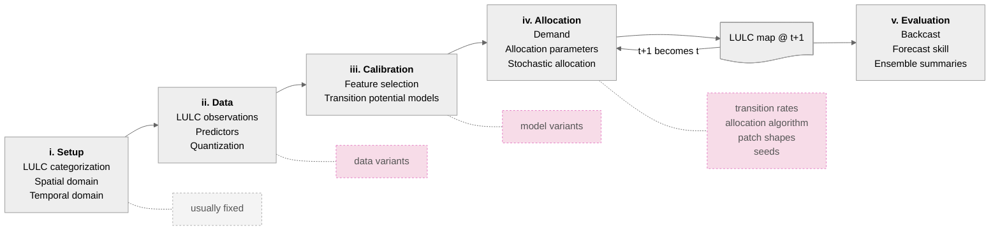

# Modelling workflow

The fundamental function of `evoland-plus` is to use a statistically calibrated, constrained model predicting locations for future land use / land cover change (LULCC), see the graph below.
Further features, such as one- or two-way coupling to other models, build on this core.

Calibration happens once, on the observed periods.
Extrapolation is autoregressive: each allocated map is the starting point for the next period, so neighborhood predictors are recomputed from it before the transition potentials for the next period are predicted with the already calibrated models.
Evaluation compares allocated maps with observations withheld from calibration (a backcast), scores ensembles as probabilistic forecasts, and summarises them as per-cell change frequencies.

The pink boxes are what may vary between runs (`runs_t`). The setup tables (`coords_t`, `periods_t`, `lulc_meta_t`) are not keyed on `id_run`, so they are the same for every run.
A child run inherits everything it does not override from its parent, so an ensemble of allocations, data or model variants shares the work done upstream of where it diverges.

Every phase reads its inputs from and writes its results to the database described in [database.md](database.md), so that each step can be rerun, inspected or replaced by another tool independently.
The [getting-started vignette](../../vignettes/evoland.qmd) walks through the phases with the functions that implement them.
